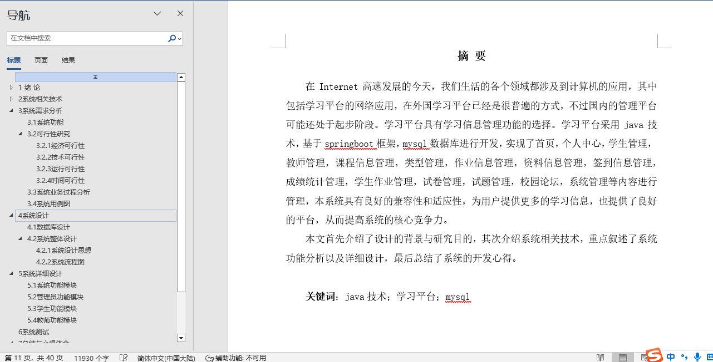
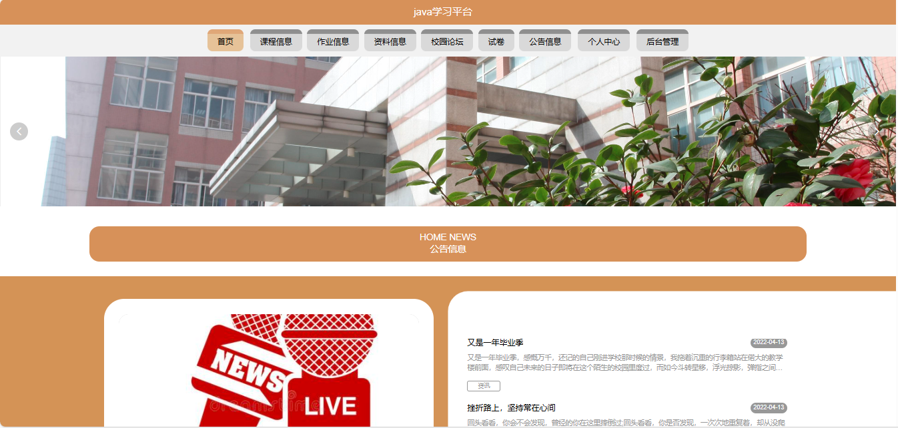
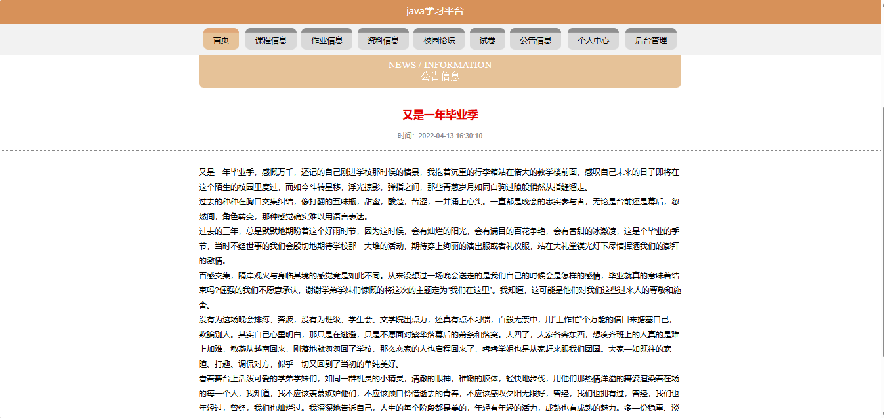
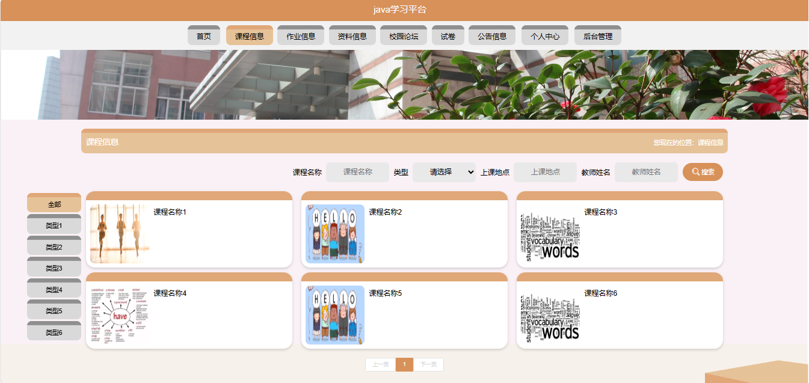
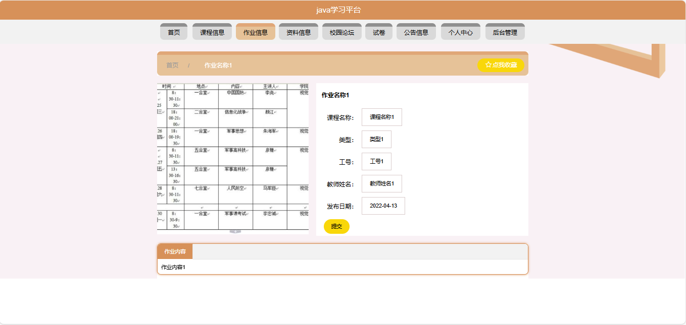
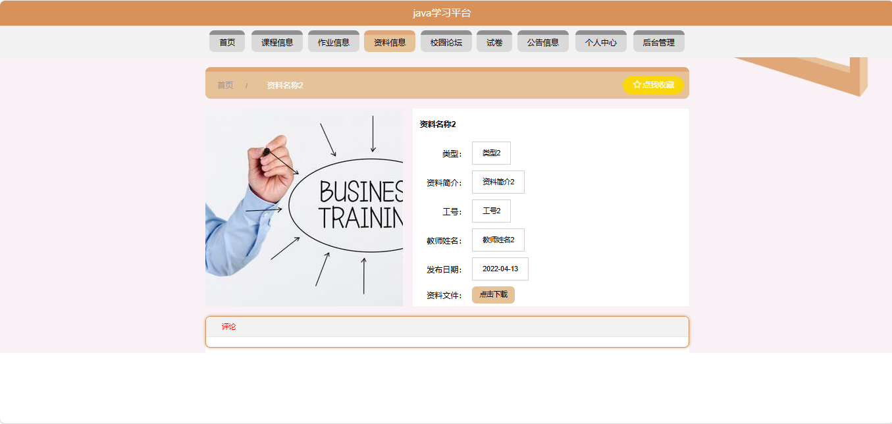
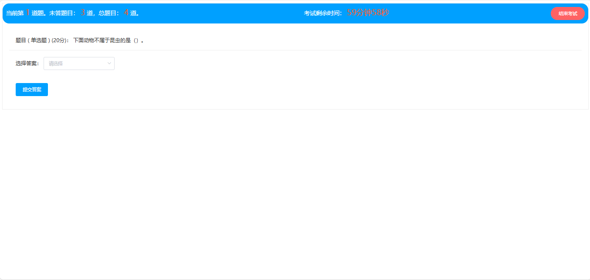
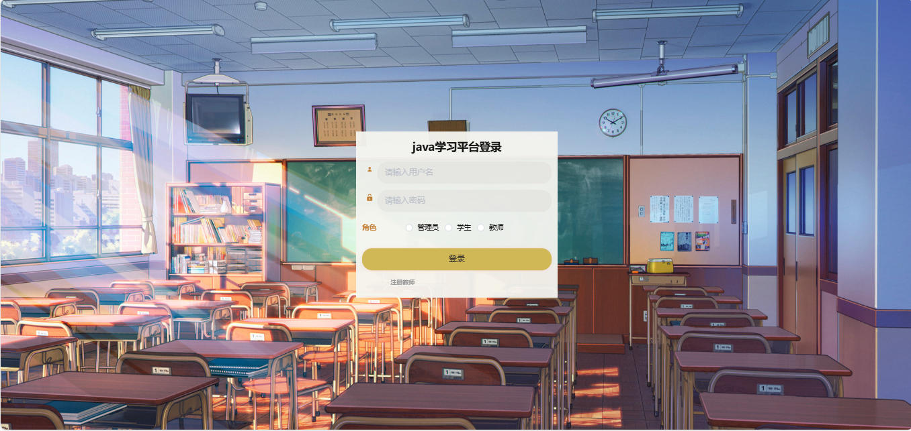
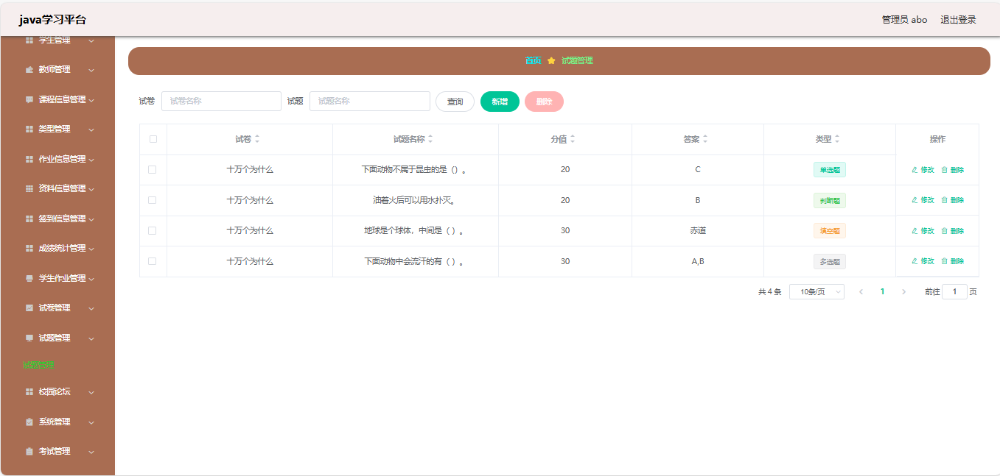

## 基于springboot的学习平台系统(程序+报告)

###  获取完整源码和sql数据库文件（完全免费）:  微信: littlepinia88 qq：1104515926
###  所有项目以及源代码本人均调试运行无问题 可支持远程安装部署调试、定制修改、代码讲解

## 项目介绍

本项目是一个基于 Spring Boot 的在线学习平台系统，面向课程学习、资料下载、作业提交、课堂签到、在线考试与成绩统计的教学业务场景，采用「用户端静态页面 + Vue 管理端」双端结构：学生在线选课学习、提交作业、参与考试，教师发布课程资料与作业、批改作业、登记成绩，管理员统一维护师生与平台数据。后端为单一 Spring Boot 服务，通过 MyBatis-Plus 操作 MySQL，管理端 Vue 产物与用户端 HTML 页面均由服务端静态托管，可作为课程设计、毕业设计或在线教育类项目的实践案例。

### 系统角色
- **管理员**：后台账号存放于 `users` 表（含 `role` 字段），登录后台维护学生、教师、课程、资料、作业、试卷、论坛与公告。
- **学生**：独立账号存放于 `xuesheng` 表，按学号登录，在线学习课程、下载资料、提交作业、签到、参加在线考试并查看成绩统计。
- **教师**：独立账号存放于 `jiaoshi` 表，按工号登录，发布课程、资料与作业，批改学生作业、登记成绩。
- **权限控制**：后端由 `AuthorizationInterceptor` 统一拦截 `/**`，依据请求头 `Token` 校验登录态，登录、注册、重置密码等接口以 `@IgnoreAuth` 放行，未登录请求返回 401。

### 用户端功能
1. **注册与登录**：学生按学号、教师按工号注册（含姓名、性别、邮箱、手机、头像），登录后返回 Token，支持退出与密码重置。
2. **课程学习**：按类型（`leixing`）筛选课程（`kechengxinxi`），查看封面、上课时间地点、课程简介、课程内容与重点难点，并发表课程评论（`discusskechengxinxi`）。
3. **资料下载**：浏览与下载教学资料（`ziliaoxinxi`），查看资料简介与附件文件，发表资料评论（`discussziliaoxinxi`）。
4. **作业提交**：查看教师布置的作业（`zuoyexinxi`），在学生作业表（`xueshengzuoye`）中填写作业内容并提交提交日期。
5. **课堂签到**：按课程查看签到信息（`qiandaoxinxi`），记录签到类型、备注与签到时间。
6. **在线考试**：从试卷（`exampaper`）抽题作答，逐题保存考试记录（`examrecord`，含我的答案 `myanswer` 与得分 `myscore`），错题在前端按未答对记录筛选形成错题本。
7. **成绩统计与论坛**：按考试名称查看成绩（`chengjitongji`），在论坛（`forum`）发帖提问并等待回复（`isdone`）。
8. **公告与收藏**：浏览公告（`news`），收藏课程、资料等内容（`storeup`）。

### 管理端功能
1. **管理员账号**：对 `users` 后台账号分页维护与重置密码。
2. **师生管理**：学生（`xuesheng`）与教师（`jiaoshi`）档案的增删改查。
3. **课程与资料管理**：维护课程（`kechengxinxi`）、资料（`ziliaoxinxi`）与类型字典（`leixing`），支持封面与附件上传。
4. **作业管理**：发布作业（`zuoyexinxi`），批改学生提交的作业（`xueshengzuoye`，可跨用户关联定位）。
5. **签到管理**：查看课程签到记录（`qiandaoxinxi`）。
6. **考试管理**：维护试卷（`exampaper`，含时长与状态）、试题（`examquestion`，含题干、选项、答案、解析、题型），查看全部答题记录（`examrecord`）。
7. **成绩统计**：按考试名称登记学生成绩（`chengjitongji`）与统计备注。
8. **论坛、评论与公告管理**：管理论坛帖子（`forum`）、两类评论与公告资讯（`news`）。

### 技术栈
- **后端框架**：Spring Boot 2.2.2.RELEASE、Spring MVC、Spring AOP，JDK 1.8
- **数据访问**：MyBatis-Plus 2.3 + mybatis-spring-boot-starter 2.1.1，MySQL，mapper XML 位于 `classpath*:mapper/*.xml`
- **前端与模板**：管理端 Vue 2 + Element UI（`admin/admin/src`，产物 `dist` 静态托管）；用户端 Layui + Element UI + jQuery/Ajax 静态页面（`front/front/pages`），富文本使用 TinyMCE
- **工程能力**：统一 `R` 响应模型、`AuthorizationInterceptor` Token 鉴权与 `@IgnoreAuth` 放行、跨域 Origin 反射放行、图片上传至 `static/upload`、Fastjson 1.2.8、Hutool 4.0.12、POI 导出
- **构建运行**：Maven + `spring-boot-maven-plugin` 打包为可执行 jar

### 核心数据表
- `xuesheng` 学生表：学号 `xuehao`、密码 `mima`、姓名 `xueshengxingming`、性别 `xingbie`、邮箱 `youxiang`、手机 `shoujihaoma`、头像 `xiangpian`
- `jiaoshi` 教师表：工号 `gonghao`、姓名 `jiaoshixingming`、性别 `xingbie`、邮箱 `youxiang`、联系手机 `lianxishouji`、相片 `xiangpian`
- `leixing` 类型表：类型名称 `leixing`（课程/资料/作业通用分类）
- `kechengxinxi` 课程表：课程名称 `kechengmingcheng`、封面 `kechengfengmian`、类型 `leixing`、上课时间 `shangkeshijian`、上课地点 `shangkedidian`、课程内容 `kechengneirong`、重点难点 `zhongdiannandian`、教师工号 `gonghao`
- `ziliaoxinxi` 资料表：资料名称 `ziliaomingcheng`、资料文件 `ziliaowenjian`、发布日期 `faburiqi`
- `zuoyexinxi` 作业表：作业名称 `zuoyemingcheng`、作业内容 `zuoyeneirong`、发布日期 `faburiqi`
- `xueshengzuoye` 学生作业表：作业名称、学生学号 `xuehao`、学生姓名 `xueshengxingming`、作业内容 `xueshengzuoye`、提交日期 `tijiaoriqi`
- `qiandaoxinxi` 签到表：课程名称、签到类型 `qiandaoleixing`、签到时间 `qiandaoshijian`、签到备注 `qiandaobeizhu`
- `exampaper` 试卷表：名称 `name`、时长 `time`、状态 `status`
- `examquestion` 试题表：所属试卷 `paperid`、题干 `questionname`、选项 `options`、分数 `score`、答案 `answer`、解析 `analysis`、题型 `type`
- `examrecord` 考试记录表：试卷 `papername`、我的答案 `myanswer`、我的得分 `myscore`
- `chengjitongji` 成绩统计表：考试名称 `kaoshimingcheng`、成绩 `chengji`、统计日期 `tongjiriqi`
- `forum` 论坛表：标题 `title`、内容 `content`、父帖 `parentid`、是否回复 `isdone`
- `news` 公告表：标题 `title`、简介 `introduction`、图片 `picture`、内容 `content`
- `storeup` 收藏表：所属用户 `userid`、关联表 `tablename`、关联 ID `refid`

### 工程结构
```
A020springbootm55rv
├── src/main/java/com
│   ├── controller/      REST 控制器（课程、资料、作业、签到、考试、论坛、成绩等）
│   ├── entity/           实体类与 model/vo 视图对象
│   ├── dao/              MyBatis-Plus Mapper 接口
│   ├── service/          业务接口与 impl 实现
│   ├── interceptor/      AuthorizationInterceptor Token 鉴权拦截器
│   ├── config/           拦截器注册、MyBatis-Plus 配置
│   ├── annotation/       @IgnoreAuth 免登录注解
│   └── utils/            R、分页、文件上传、MD5、SQL 过滤等工具
├── src/main/resources
│   ├── mapper/          MyBatis mapper XML
│   ├── admin/admin/src  管理端 Vue2 + Element UI 源码
│   ├── admin/admin/dist 管理端打包产物（静态托管）
│   ├── front/front/pages 用户端 HTML 页面（home、kechengxinxi、exampaper、forum 等）
│   ├── static/upload/   上传文件目录
│   └── application.yml  端口、数据源、MyBatis-Plus 配置
├── screenshot/          运行截图
└── pom.xml
```

### 访问入口
- 用户端：`http://localhost:8080/springbootm55rv/front/front/index.html`
- 管理端：`http://localhost:8080/springbootm55rv/admin/admin/dist/index.html`
- 后端 API 基址：`http://localhost:8080/springbootm55rv`（登录接口为 `POST /users/login`、`/xuesheng/login`、`/jiaoshi/login`）

### 补充说明
- 端口 8080、上下文路径 `/springbootm55rv`、数据库 `a020_springbootm55rv` 均在 `src/main/resources/application.yml` 中配置，首次运行需先导入 SQL 并按本机 MySQL 调整账号密码（默认 root/123456）。
- 学生与教师密码以明文比对、登录态基于数据库 Token 表，鉴权由 `AuthorizationInterceptor` 完成，未使用 Shiro/Spring Security 权限框架。
- 在线考试为前端逐题保存、后端按题判分的模拟流程，未接入防作弊等考试安全机制；上传文件保存在本地 `static/upload` 目录。

## 运行环境
- JDK版本：JDK1.8及以上
- 开发工具：IDEA、Ecplise、Myecplise都可以
- 数据库: MySQL5.7及以上
- Node：14.14.0及以上

## 运行截图

















